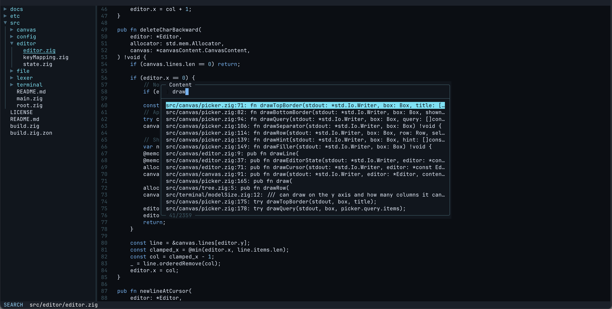

# Juno

Migrated from Codeberg:
https://codeberg.org/thijsrijkers/juno

An opinionated terminal text editor.

Juno takes the modal editing philosophy developers already know and love, and builds the tools they actually reach for every day directly into the editor itself. No plugin manager. No config marathon. Compile it, install it, open it, start working.

## Why Juno

I use Neovim as my daily driver. I like it, the customization, the themes, the plugin ecosystem. This isn't a "Vim is bad" project.

But a few things kept bothering me:

**Core workflows shouldn't depend on third-party plugins.**
Fuzzy finding, project tree navigation, multi-file search, these aren't niche features. Nearly every developer using Vim or Neovim installs something like Telescope, fzf, or nvim-tree on day one. If almost everyone needs it, it shouldn't be a plugin someone else has to maintain, version, and keep compatible. It should just be part of the editor.

**Vim's rendering model is showing its age.**
Vim/Neovim's drawing pipeline is built around assumptions from decades old terminals, and it works, but it's not simple. Modern terminal emulators (Ghostty, for example) support far more directly than what SGR-era escape sequence juggling assumes. Juno's rendering follows the KISS principle: draw the screen in the most straightforward way a modern terminal actually allows, rather than carrying forward complexity that used to be necessary but no longer is.

**The out-of-box experience should be complete.**
Install Juno, and you have a real editor, not a blank slate waiting for a `plugins.lua` file.

<hr/>

<p align="center">
  
</p>

<hr/>

## Philosophy

- **Batteries included, not batteries required.** Fuzzy file finding, project-wide search, and a file tree are core features, not plugins.
- **KISS rendering.** Target modern terminal capabilities instead of maximizing backward compatibility with hardware that hasn't existed in decades.
- **Fast path to productivity.** Compile, install, run. No required setup step before the editor is usable.
- **Vim-inspired, not Vim-bound.** Modal editing, insert mode, and `hjkl` style movement stick around because they work. But motions are famously hard to learn, Juno keeps the core ideas of modes and movement while taking motions themselves in a different direction.


## Features

- Modal editing (normal / insert / visual, Vim inspired keybindings)
- Built-in fuzzy finder for files and in-project search (no Telescope required)
- Built-in project tree / directory navigation
- Simple, modern rendering pipeline built for current terminal emulators
- Single binary, no runtime plugin dependencies for core functionality
- Written in Zig, no runtime, simple cross-compilation, small static binary

## Installation

Juno is written in Zig and requires Zig 0.16.0 or later.

```bash
git clone https://codeberg.org/thijsrijkers/juno.git
cd juno
./install.sh
```

## Usage

Open Juno with no arguments to see your config:

```bash
juno
```

Open a specific file:

```bash
juno path/to/file.rs
```

Open a directory as a project (launches with the project tree active):

```bash
juno path/to/project/
```

## Roadmap

- [x] Core modal editing engine
- [x] Built-in fuzzy finder (files + content)
- [x] Built-in project tree
- [ ] Config file format and config viewer (`juno` with no args)
- [ ] Theming support
- [ ] Improving design and visual elements
- [ ] Plugin API for *optional* extensions (core features remain built-in)

## Contributing

Juno is early-stage. Issues, ideas, and pull requests are welcome, especially around the core built-in tooling (finder, tree, search) and the rendering engine.

## License

See the [LICENSE](https://codeberg.org/thijsrijkers/juno/src/branch/main/LICENSE) file for details.
